# Audit responsive — toyso-site

Date : 30/10/2026 · Base : `main` @ 38fb85e · Aucune correction appliquée.

## Méthode

- Serveur de dev Vite, Chrome headless piloté par CDP (émulation mobile + tactile sous 768px).
- 19 routes (toutes celles de `src/router/index.ts`, une page détail par collection, une URL inconnue pour la 404).
- 7 largeurs : 320, 375, 700, 768, 1024, 1440, 1920px. Hauteurs : 812 (mobile), 1024 (tablette), 900 (desktop).
- Mesures automatiques par page : `scrollWidth` vs largeur visible, éléments qui sortent de l'écran, texte qui déborde de sa boîte, nombre de lignes et interligne des `.text-title`, cibles cliquables < 44px, position des éléments du header.
- Mode sombre exclu : il ne change pas le layout.
- Captures recadrées dans [`docs/responsive-audit/`](responsive-audit/). Le petit bouton noir en bas des captures est Vue DevTools (dev uniquement, absent en prod).

## Synthèse

| # | Gravité | Problème | Largeurs |
|---|---|---|---|
| 1 | **Bloquant** | Image de la page détail personnage plus large que l'écran → scroll horizontal | ≤ 1024px |
| 2 | Gênant | Titres sur 2 lignes qui se chevauchent (`line-height: 0.7`) | 768–1023px |
| 3 | Gênant | Paragraphes `text-body` à interligne 1 : lignes et surlignages collés | 640–767px |
| 4 | Gênant | Sous-titres sur 2 lignes qui se chevauchent (`line-height: 0.9`) | ≥ 1280px |
| 5 | Gênant | Texte justifié + `text-wrap: balance` sur mobile : grands trous entre les mots | < 640px |
| 6 | Gênant | Icônes du header à 36×36px, sous le minimum tactile de 44px | toutes |
| 7 | Gênant | Bouton « ENVOYER » du contact rendu comme un lien souligné | < 640px |
| 8 | Gênant | Header serré : icône « dev » collée à LinkedIn | 768px |
| 9 | Cosmétique | Titre d'un seul long mot qui dépasse sa boîte (« tronchatonneuse ») | 320–375px |
| 10 | Cosmétique | Liens LinkedIn/GitHub masqués mais toujours présents : trou dans le header mobile | < 640px |
| 11 | Cosmétique | Liens du fil d'Ariane petits et rapprochés (27×28px) | < 640px |
| 12 | Cosmétique | Galerie : rangées de hauteurs inégales quand les ratios se mélangent | ≥ 768px |
| 13 | Cosmétique | Captures du jeu illisibles sur mobile, sans zoom possible | < 640px |
| 14 | Cosmétique | Tailles de police non monotones selon la largeur | 768→1024, 1024→1440 |

**Ce qui fonctionne :** aucun scroll horizontal ailleurs que sur les pages détail personnage (19 routes × 7 largeurs). Les galeries passent bien de 1 à 2 puis à 4 colonnes. L'alternance gauche/droite des paragraphes tient à partir de 640px. `/dev/la-haute-tour` rend correctement à toutes les largeurs.

---

## 1. Image de la page détail personnage plus large que l'écran — **Bloquant**

- **Pages :** `/art/characters/:id` (toutes). Mesuré : `chainsaw` et `yellow` (portrait) à 320/375px, `perfume` (paysage) à 375, 768 et 1024px.
- **Ce qui casse :** la page défile horizontalement. `scrollWidth` = 502px pour un écran de 375px (portrait), et 1038px pour 768px (paysage). L'image est coupée à droite.
- **Cause :** [`src/views/art/CharacterDetail.vue:14`](../src/views/art/CharacterDetail.vue:14), `class="max-w-[1000px] max-h-[85vh] mx-auto"`. `max-w-[1000px]` remplace le `max-width: 100%` du preflight Tailwind. Seule la hauteur (85vh) limite l'image, et sa largeur suit son ratio sans tenir compte de l'écran.
- **Correction :** `class="w-auto max-w-[min(100%,1000px)] max-h-[85vh] mx-auto"`.

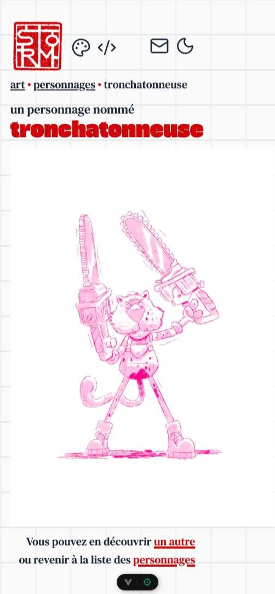
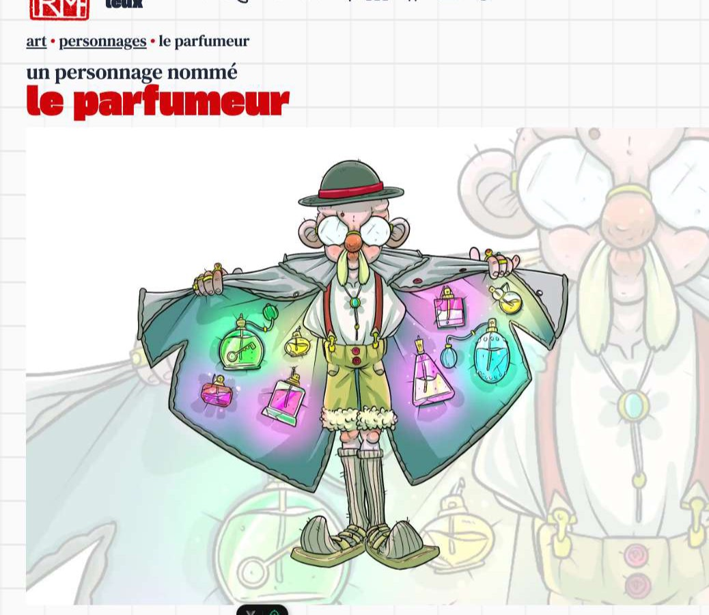

## 2. Titres sur 2 lignes qui se chevauchent — Gênant

- **Pages :** `/dev/keynotes/once-upon-a-time-in-frontend`, `/dev/keynotes/lets-build-a-lighthouse`, `/art/studies/lord-of-the-rings` (et tout titre qui passe sur 2 lignes).
- **Largeur :** 768–1023px.
- **Ce qui casse :** la police fait 53,8px pour un interligne de 37,6px. Les 2 lignes se recouvrent : « Once upon a » et « time in frontend » se mélangent.
- **Cause :** [`src/style.css:136`](../src/style.css:136), `line-height: 0.7`. À 1024px, `line-height: 4vw` pour `5vw` (0.8) ([`style.css:154`](../src/style.css:154)) passe tout juste.
- **Correction :** `line-height: 1` dans les 2 media queries (Gasoek One est très haute : ne pas descendre sous 0.95).

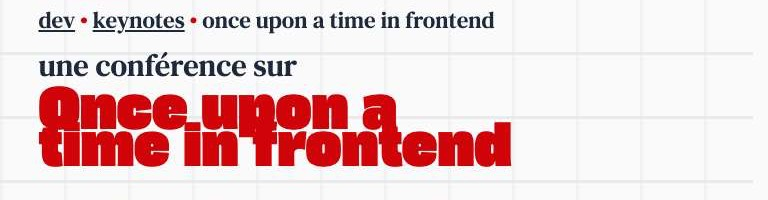

## 3. Paragraphes à interligne 1 entre 640 et 767px — Gênant

- **Pages :** toutes celles qui ont du `text-body`. Les plus visibles : `/dev`, `/art`, `/contact`.
- **Largeur :** 640–767px (grand mobile en paysage, petite tablette). Mesuré à 700px : 28px/28px.
- **Ce qui casse :** les lignes se touchent. Les blocs `.text-marker` (fond rouge) mordent sur la ligne du dessus (« Senior Frontend Engineer », « projets »).
- **Cause :** [`src/style.css:130`](../src/style.css:130), `.text-body { font-size: 4vw; line-height: 1 }`.
- **Correction :** `line-height: 1.5`. On peut aussi baisser la taille : 4vw donne 28px à 700px, plus gros qu'à 768px (23px).

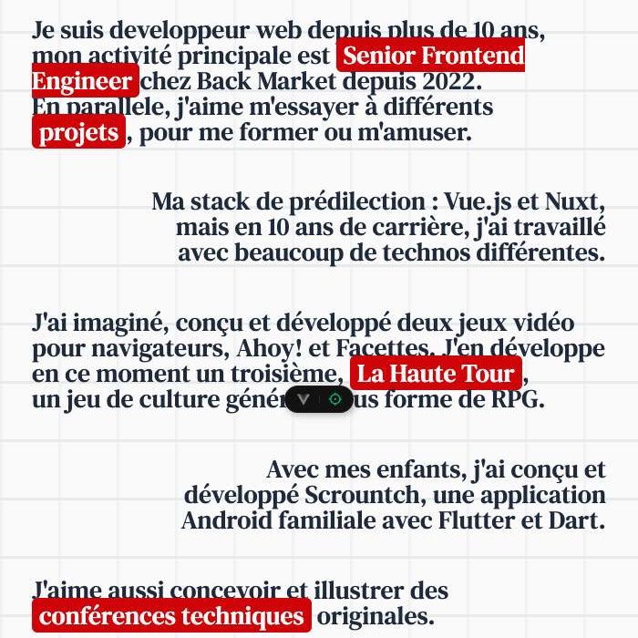

## 4. Sous-titres sur 2 lignes qui se chevauchent — Gênant

- **Pages :** `/dev` (« Vous avez un projet en tête ? / N'hésitez pas à me contacter »), `/art` (« Vous hésitez ? / Découvrez… »), et tout `.text-subtitle` qui passe sur 2 lignes.
- **Largeur :** ≥ 1280px. Mesuré à 1440px : 28,8px pour un interligne de 25,9px.
- **Ce qui casse :** la 2ᵉ ligne et son surlignage rouge recouvrent le bas de la 1ʳᵉ.
- **Cause :** [`src/style.css:175`](../src/style.css:175), `line-height: 0.9`.
- **Correction :** `line-height: 1.3`.

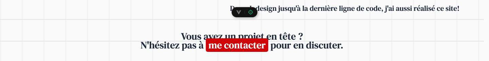

## 5. Texte justifié sur mobile — Gênant

- **Pages :** `/dev`, `/art`, 404.
- **Largeur :** < 640px. Pire à 320px.
- **Ce qui casse :** de grands trous entre les mots (« Ma stack de prédilection : », « deux jeux vidéo pour »). Le `text-wrap: balance` global raccourcit en plus les lignes avant de les justifier.
- **Cause :**
  - `text-justify sm:text-left|right` dans [`src/views/dev/Home.vue:7`](../src/views/dev/Home.vue:7) (et lignes 15, 19, 26, 29, 35), [`src/views/art/Home.vue:7`](../src/views/art/Home.vue:7) (et 15, 21, 30), [`src/views/NotFound.vue:8`](../src/views/NotFound.vue:8).
  - Règle globale `* { text-wrap: balance }` dans [`src/style.css:55`](../src/style.css:55).
- **Correction :** remplacer `text-justify` par `text-left`. Réserver `text-wrap: balance` aux titres et sous-titres (`.text-title, .text-subtitle`), et mettre `text-wrap: pretty` sur les paragraphes.

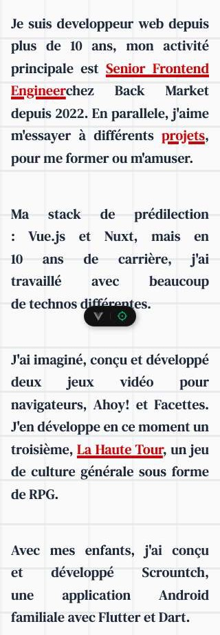

## 6. Cibles tactiles du header trop petites — Gênant

- **Pages :** toutes.
- **Largeur :** toutes. C'est un problème surtout sur tactile (< 768px).
- **Ce qui casse :** les liens art, dev, contact et le bouton mode sombre font 36×36px, sous les 44×44px recommandés par Apple et le WCAG 2.5.5. Ils restent au-dessus du minimum AA de 24px.
- **Cause :** [`src/components/Header.vue:13`](../src/components/Header.vue:13), 19, 26, 31, 35, 42-43 : `:size="36"` sans padding sur le lien.
- **Correction :** ajouter `min-w-11 min-h-11 flex items-center justify-center` (44px) sur chaque `<router-link>`, `<a>` et `<button>` du header, sans changer la taille de l'icône.

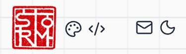

## 7. Bouton « ENVOYER » du contact rendu comme un lien — Gênant

- **Page :** `/contact`.
- **Largeur :** < 640px.
- **Ce qui casse :** sous 640px, `.text-marker` n'est qu'un texte rouge souligné. Le bouton d'envoi du formulaire ressemble à un lien, sans fond ni bordure. Les 3 paragraphes d'intro n'ont que 7px d'écart (`mb-[2vw]`), et le dernier est collé au label « Nom ».
- **Cause :** [`src/views/Contact.vue:125`](../src/views/Contact.vue:125) réutilise `text-marker`, dont le style mobile est défini dans [`src/style.css:88`](../src/style.css:88). Espacement : [`Contact.vue:7`](../src/views/Contact.vue:7), 15, 24.
- **Correction :** donner au bouton son propre style, actif à toutes les tailles (`bg-(--color-highlight) text-(--color-background) rounded-lg`). Mettre `mb-6` sur les paragraphes.

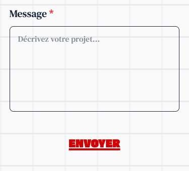

## 8. Header serré à 768px — Gênant

- **Pages :** toutes.
- **Largeur :** 768px (début du breakpoint `md`). Ça se dégage vers 900px.
- **Ce qui casse :** les libellés « florian leux », « art », « & », « dev » apparaissent d'un coup. L'icône `</>` termine à 534px, exactement là où commence l'icône LinkedIn : plus aucun espace entre les deux groupes.
- **Cause :** [`src/components/Header.vue:8`](../src/components/Header.vue:8), 12, 15, 18 : `hidden md:block` + `mr-[5vw]` + `text-body` (3vw à 768px).
- **Correction :** passer ces 4 éléments en `hidden lg:block` / `lg:inline`, ou cacher seulement « florian leux » jusqu'à `lg`. Ajouter `gap-4` au `<header>` pour garantir un espace minimal.

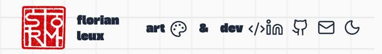

## 9. Titre d'un seul long mot qui dépasse — Cosmétique

- **Page :** `/art/characters/chainsaw` (« tronchatonneuse »). Même risque pour tout titre d'œuvre fait d'un seul long mot.
- **Largeur :** 320 et 375px. Contenu de 353px dans une boîte de 338px à 375px.
- **Ce qui casse :** le titre déborde de 15px dans la marge droite. Il reste dans l'écran : pas de scroll.
- **Cause :** [`src/views/art/CharacterDetail.vue:7`](../src/views/art/CharacterDetail.vue:7) avec `.text-title { font-size: 10vw }` ([`src/style.css:69`](../src/style.css:69)).
- **Correction :** `overflow-wrap: anywhere; hyphens: auto;` sur `.text-title` (`lang="fr"` est déjà présent).

Capture : voir la n° 1 (titre en haut).

## 10. Liens LinkedIn/GitHub masqués mais présents — Cosmétique

- **Pages :** toutes.
- **Largeur :** < 640px.
- **Ce qui casse :** seule l'icône est masquée (`hidden sm:block` sur le SVG). Les `<a>` vides restent dans le flex et ajoutent 2 `gap` : trou de 60px entre `</>` et l'enveloppe à 375px. Ce sont aussi 2 liens invisibles mais atteignables au clavier. Sur mobile, LinkedIn et GitHub sont inaccessibles.
- **Cause :** [`src/components/Header.vue:24`](../src/components/Header.vue:24) et 29 (le `<a>`), avec 27 et 32 (la classe `hidden` posée sur l'icône).
- **Correction :** déplacer `hidden sm:block` de l'icône vers le `<a>`. Envisager aussi de garder ces liens sur mobile, par exemple en bas de `/contact`.

Capture : voir la n° 6 (le trou entre `</>` et l'enveloppe).

## 11. Fil d'Ariane : liens petits et rapprochés — Cosmétique

- **Pages :** toutes celles qui ont un `Breadcrumb`.
- **Largeur :** < 640px.
- **Ce qui casse :** « art » fait 27×28px et « illustrations » 108×28px, sous les 44px de hauteur.
- **Cause :** [`src/components/Breadcrumb.vue:4`](../src/components/Breadcrumb.vue:4).
- **Correction :** `inline-block py-2` sur le `router-link` (hauteur ≥ 44px sans changer le visuel).

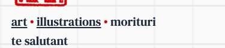

## 12. Galerie : rangées de hauteurs inégales — Cosmétique

- **Pages :** `/art/all` surtout, et toute galerie qui mélange les ratios.
- **Largeur :** ≥ 768px (4 colonnes).
- **Ce qui casse :** quand une rangée « portrait » est complétée avec des images paysage, ou quand les images portrait n'ont pas toutes le même ratio, les cellules ont des hauteurs différentes. `items-center` les centre verticalement, ce qui laisse des bandes vides au-dessus et en dessous.
- **Cause :** [`src/composables/useImageLayout.ts:103`](../src/composables/useImageLayout.ts:103) (remplissage d'une rangée portrait par des paysages), et `items-center` dans [`src/components/ImageGallery.vue:6`](../src/components/ImageGallery.vue:6) et 28.
- **Correction :** donner un ratio fixe aux cellules (`aspect-[3/4]` en portrait, `aspect-video` en paysage) avec `object-cover`. Autre option : ne jamais mettre de paysage dans une rangée portrait (créer une rangée paysage à la place).

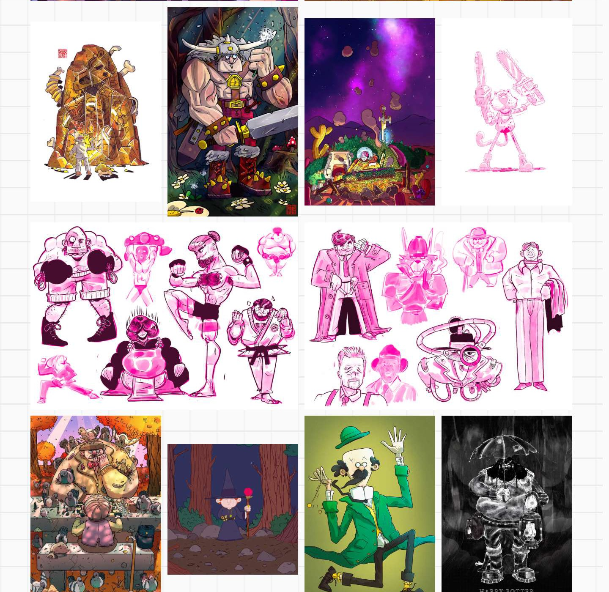

## 13. Captures du jeu illisibles sur mobile — Cosmétique

- **Page :** `/dev/la-haute-tour`. Même chose pour les slides des 2 keynotes.
- **Largeur :** < 640px (1 colonne de 337px).
- **Ce qui casse :** les écrans du jeu (questions, grimoire, inventaire) sont réduits au point que leur texte est illisible. Les images ne sont pas cliquables, donc impossible de les agrandir.
- **Cause :** [`src/views/dev/LaHauteTour.vue:34`](../src/views/dev/LaHauteTour.vue:34). `ImageGallery` ne rend un lien que si l'œuvre a un `to` ([`ImageGallery.vue:9`](../src/components/ImageGallery.vue:9)).
- **Correction :** sans `to`, envelopper l'image dans un `<a :href="image.src" target="_blank">`, ou ajouter une lightbox.

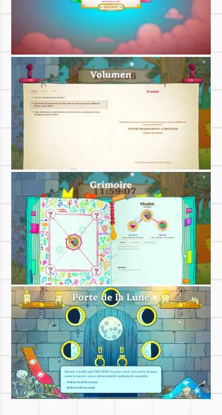

## 14. Tailles de police non monotones — Cosmétique

- **Pages :** toutes.
- **Mesures** (`/dev`) :

  | Largeur | `.text-title` | `.text-subtitle` | `.text-body` |
  |---|---|---|---|
  | 375 | 37,5 / 45 | 22,5 / 22,5 | 20,3 / 32,5 |
  | 700 | 63 / 70 | 35 / 42 | **28 / 28** |
  | 768 | 53,8 / **37,6** | 30,7 / 43 | 23 / 32,3 |
  | 1024 | 51,2 / 41 | 30,7 / 43 | **20,5** / 26,6 |
  | 1440 | 57,6 / 57,6 | **28,8 / 25,9** | 21,6 / 32,4 |

- **Ce qui casse :** les textes rapetissent quand l'écran grandit (700 → 768, 768 → 1024 pour le corps, 1024 → 1440 pour le sous-titre). Sous 640px, `.text-body` vaut `2.5vh` : il dépend de la **hauteur** de l'écran (16,7px sur un iPhone SE de 667px de haut, 23px sur un téléphone de 932px).
- **Cause :** les paliers en `vw` de [`src/style.css:67-182`](../src/style.css:67), et `font-size: 2.5vh` à la [ligne 80](../src/style.css:80).
- **Correction :** remplacer les paliers par une `clamp()` par classe. Par exemple `.text-body { font-size: clamp(1.125rem, 0.9rem + 0.9vw, 1.75rem); line-height: 1.5 }`, et de même pour le titre et le sous-titre. Les problèmes 2, 3 et 4 disparaissent du même coup.

Capture : voir la n° 3 (texte de 28px à 700px, plus gros qu'à 768px).

---

## Hors périmètre (repéré au passage)

- Espaces manquants autour de liens : `Engineer</a>chez` ([`src/views/dev/Home.vue:10`](../src/views/dev/Home.vue:10)), `des<router-link` ([`src/views/art/StudyDetail.vue:26`](../src/views/art/StudyDetail.vue:26)).
- Le script anti-flash de `index.html` ajoute la classe `dark`, alors que `useDarkMode` utilise `dark-mode` : au chargement en mode sombre, la page s'affiche d'abord en clair.
